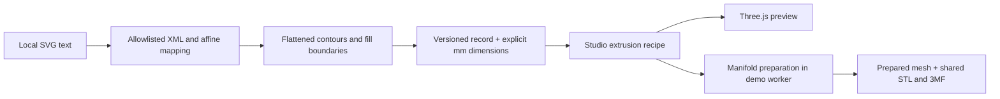

# SVG import: geometry and manufacturing contract

WT-003 adds an isolated model source, not a second manufacturing pipeline. It has no production Studio entry point. The browser harness requires the same Three.js and Manifold versions as Studio and uses its checked recipe preparation and Z-up exporters.

## Public interface (`svg-import/index.js`)

| API | Contract |
| --- | --- |
| `await parseSvgArtwork(text, { name })` | Returns sampled contour `loops` (`outer`/`hole`), visual `bounds`, `components`, warnings, and source metadata with SHA-256. No arbitrary SVG DOM or fetch is involved. |
| `createSvgImport(artwork, { widthMm, heightMm?, depthMm, rotationDeg? })` | Validates and produces a version-1 JSON record. Omit height to maintain the artwork aspect ratio. Width and height describe the flat footprint before rotation; depth is extrusion along +Y. |
| `buildSvgExtrusionRecipe(record, { pixelHoles? })` | Returns a single-material Studio recipe centred on the sampled artwork bounding box, with one `kind:'extrude'` part and separately validated optional pixel cutters. `bounds.width/depth` are rotated X/Z spans, and `bounds.height` is extrusion depth. |
| `prepareSvgImport(THREE, wasm, record, { pixelHoles?, onProgress? })` | Calls unchanged `prepareRecipe`; confirms actual mesh dimensions, positive finite volume and the triangle cap. Returns `{prepared, report}`. Pass `prepared` to `exportMaterialBodies`. |
| `serializeSvgImport(record)` / `restoreSvgImport(json)` | Validate a v1 record and preserve canonical sampled coordinates, contour order/orientation, source metadata, dimensions, aspect lock and in-plane rotation. Raw XML is not retained or reopened. |

SVG right/down maps to Studio +X/+Z. Rotation is in the X/Z plane about the source centre; the bottom stays at Y = 0. Existing exporters transform `(X,Y,Z)` to `(X,-Z,Y)`, so the print bed is Z = 0 and the extrusion height becomes Z. File `viewBox` and absolute viewport sizes (`px`, `mm`, `cm`, `in`, `pt`, `pc`, `Q`) set the coordinate mapping, not the print scale. Sampled contours outside the viewport are refused rather than clipped: fit the page to the drawing or crop it to closed paths before export. The print width is explicit. Unlocked width/height stretches the artwork before rotation. Preview and preparation use the same planar contours.

## Support and refusal policy

Closed filled paths, polygons, plain rectangles, circles and ellipses are supported. Path lines, curves and arcs are flattened after nested affine mapping. `evenodd` and `nonzero` apply per element; only boundaries where aggregate fill actually changes become contours. A hole wholly inside one outer contour is carried into Manifold, not rendered as a flat overlay.

Crossing, touching, self-intersecting or degenerate boundaries are refused; resolve them into clean outlines with a vector union/difference operation first. Separate islands, including an island inside a hole, are reported and refused at recipe time rather than fused or called a connected print. Save those as separate SVGs. Bevels, arbitrary mesh repair, multi-material SVG paint, text/font conversion, stroke expansion, and multiple-part print jobs are out of scope.

Animation, scripts, event attributes, foreign/raster content, external references, CSS-driven appearance, unresolved clipping/masking/filtering and geometry-changing unsupported elements are rejected rather than ignored. Convert to closed fills, flatten effects, and outline strokes/fonts in a vector editor. The importer does not inject source markup; the browser renders only derived contours and meshes. Inputs are bounded by byte, XML nesting, curve, contour, coordinate and triangle guardrails. Practical limits include 256 KiB source, 128 loops, 6,000 sampled points, 40,000 prepared triangles, 0.5–500 mm requested footprint sides, 0.2–100 mm depth, and a 0.05 mm curve-error ceiling at requested scale. The 0.05 mm small-contour and inter-contour screening is **not** a comprehensive nozzle or wall-thickness analysis.

The optional Build adapter reuses the Studio vertical pixel-cutter shape, then checks the complete cutter footprint plus 1 mm clearance against the true outer boundary and every opening. Final Manifold preparation still rejects a non-cutting bore. This proves a simple vertical through-bore, **not** general curved cable routing, blind LED fittings, or mounting strength.
